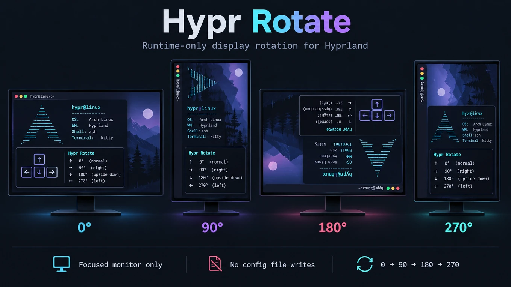
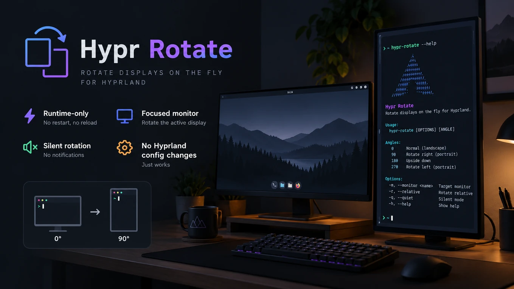

# Hypr Rotate

**One shortcut. Four orientations. Zero persistence.**

<p align="center">
  
</p>

A small, standalone, **runtime-only display rotation utility for Hyprland**. Run `hypr-rotate` to cycle the currently focused monitor through four orientations—without rewriting monitor configuration or starting a background service.

<sub>The images in this README are conceptual illustrations, not screenshots of a Hypr Rotate interface. Hypr Rotate is a command-line utility with no GUI.</sub>

## Quick start

```bash
git clone https://github.com/Magik23/hypr-rotate.git
cd hypr-rotate
install -Dm755 hypr-rotate ~/.local/bin/hypr-rotate
```

Ensure `~/.local/bin` is on your `PATH`, then run:

```bash
hypr-rotate
```

Each invocation rotates the **focused monitor** to the next orientation. Successful operation is silent; errors are reported to standard error.

## Rotation cycle

```text
0° Landscape → 90° Portrait → 180° Inverted → 270° Portrait → 0° Landscape
```

No settings to save and no monitor configuration to rewrite. Your orientation at startup still comes from your own Hyprland monitor configuration.

## Keyboard shortcut

Hypr Rotate **does not install a keyboard binding automatically**. `Super+Alt+R` is a suggested combination; choose another if it conflicts with your setup.

**Omarchy (Lua bindings)** — add to `~/.config/hypr/bindings.lua`:

```lua
o.bind("SUPER + ALT + R", "Hypr Rotate", "hypr-rotate")
```

**Standard Hyprland Lua configuration** — use the appropriate Lua binding syntax:

```lua
hl.bind("SUPER + ALT + R", hl.dsp.exec_cmd("hypr-rotate"))
```

Use **only the example appropriate for your setup**, and avoid duplicating an existing binding. Changing the keyboard shortcut does not require modifying Hypr Rotate.

## Designed to stay out of the way

<p align="center">
  
</p>

- **Focused monitor only.** Rotates the monitor Hyprland reports as focused.
- **Runtime-only.** No persistent edits to `monitors.lua`, `hyprland.lua`, `hyprland.conf`, or other monitor configuration files.
- **Silent on success.** No notification popup, daemon, or background service.
- **Independent.** No dependency on Omarchy, Marchine, MAME, or other applications.

The utility queries Hyprland for the focused monitor and current transform, advances the four non-mirrored orientations, and applies the result through the Hyprland Lua monitor API. It does not install, alter, or depend on a wallpaper renderer.

## Requirements

- Bash
- `jq`
- Hyprland with the Lua monitor API (`hyprctl eval` and `hl.monitor`)

On Arch Linux, install `jq` if needed:

```bash
sudo pacman -S --needed jq
```

Tested on Omarchy with Hyprland's Lua configuration system. Compatibility with older Hyprland versions has not been verified.

## Test and update

The repository includes simulated regression tests; they **do not rotate your actual display**:

```bash
bash tests/hypr-rotate_test.sh
```

To update a cloned installation:

```bash
cd ~/Projects/hypr-rotate  # Or wherever you cloned the repository
git pull --ff-only
install -Dm755 hypr-rotate ~/.local/bin/hypr-rotate
```

## Known limitations

- Mirror/flipped transforms are not part of the rotation cycle.
- Requires a supported Hyprland Lua monitor API.
- Multi-monitor behavior is covered by simulated tests, but hasn't been separately verified on a live multi-monitor setup.

## Uninstall

```bash
rm ~/.local/bin/hypr-rotate
```

Remove any keyboard binding you added separately.

## License

MIT. See [LICENSE](LICENSE).
